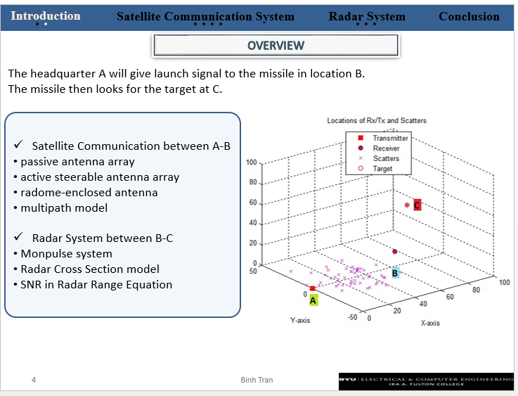
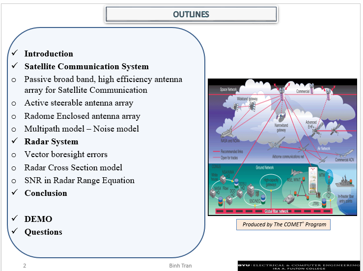
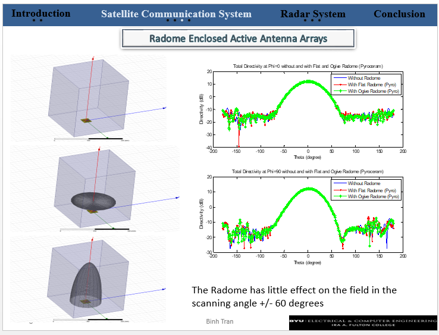
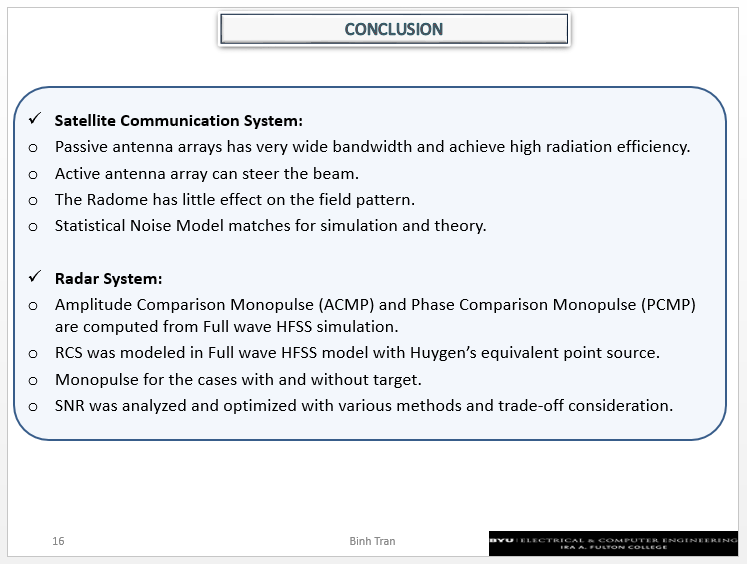

# Radar-System Modeling and Antenna-Array Analysis

An overview of the radar, antenna-array, and propagation-modeling topics presented in the research slides, alongside the related satellite-communications work.

> **Scope and evidence:** This is a summary of an academic presentation, not evidence of a deployed radar or guidance system. It records the subject areas and modeling workflow at a high level. It does not provide weapon-guidance procedures, targeting instructions, system-design parameters, or operational performance-optimization guidance. Scenario-specific figures in the source notes have not been independently validated and are not presented as verified results here.

## Project Overview

The presentation brings together two related areas of electromagnetic engineering:

1. **Satellite communications:** passive and active antenna arrays, radome-enclosed array models, and statistical propagation/noise concepts.
2. **Radar-system analysis:** monopulse comparison methods, array-error concepts, electromagnetic scattering models, and signal-to-noise considerations.

The work is presented as simulation and system-analysis research. The slides provide visualizations and summary conclusions, but should not be read as a fielded-system specification or independent validation report.

*Overview slide. The diagram is a presentation-level scenario illustration, not a deployment diagram or operating procedure.*

*Outline slide showing the major study sections and analysis topics.*

## System Context

The presentation uses a conceptual system scenario to discuss how communications, antenna hardware, propagation, and radar analysis relate. At a broad level, the material moves from antenna-array and radome modeling to analysis of received-field behavior and radar-related metrics.

This framing helps explain the engineering interfaces considered in the slides:

- **Antenna subsystem:** passive-array and active-array concepts, including beam steering.
- **Propagation environment:** multipath and statistical-noise modeling as factors that influence simulated fields.
- **Protective enclosure:** radome models used to compare antenna-pattern behavior with and without an enclosure.
- **Analysis layer:** monopulse, scattering, and signal-to-noise topics treated as modeling subjects.

These are presentation-level categories; the README intentionally does not turn them into implementation steps or operating guidance.

## Antenna Arrays and Radome Modeling

One section compares electromagnetic models of an active antenna array in several enclosure configurations. The slide places model views alongside radiation-pattern plots at two angular cuts. Its stated conclusion is that the modeled radome has a limited effect on the field pattern in the illustrated scan range.

That conclusion is specific to the modeled configurations shown. The slide alone does not establish performance across other designs, materials, frequencies, environmental conditions, or qualification tests.

*Radome/array model views and pattern comparisons from the presentation. These are simulation figures, not independent qualification or deployment evidence.*

## Radar Analysis Topics

The radar section identifies several areas for academic modeling and comparison:

- **Amplitude- and phase-comparison monopulse:** comparison of two analysis approaches using simulated array fields.
- **Vector-error analysis:** examination of how modeled array and propagation effects relate to angular-error representations.
- **Scattering and RCS modeling:** electromagnetic scattering is treated as a simulation topic, including a Huygens-equivalent-source approach noted in the presentation.
- **Statistical propagation/noise:** comparison of a statistical noise model with simulation/theory is listed among the presentation conclusions.
- **Signal-to-noise analysis:** the slides discuss SNR as a system-analysis metric and identify trade-offs among analysis scenarios.

The material supports describing these as study topics; it does not, by itself, substantiate a complete operational tracking system or the specific performance claims in the original draft notes.

## Modeling Workflow Described

The presentation can be summarized as a non-operational analysis sequence:

1. Define conceptual antenna, radome, and propagation cases for comparison.
2. Generate electromagnetic field or pattern results using full-wave simulation.
3. Examine array response using monopulse and vector-error analysis concepts.
4. Consider scattering and statistical noise as part of the modeled environment.
5. Compare modeled behaviors and discuss system-level SNR trade-offs.

This sequence is a summary of the presentation's analytical organization, not a reproducible procedure. The README does not supply simulation settings, target parameters, implementation details, or guidance for improving weapon performance.

## Summary of the Presentation's Conclusions

The final slide groups conclusions under satellite communications and radar-system analysis. In summary, it reports:

- Passive and active antenna-array work, including beam-steering concepts.
- A comparison of array-field patterns for modeled radome cases.
- Statistical-noise modeling compared with simulation and theory.
- Monopulse and electromagnetic-scattering analyses based on simulated fields.
- SNR discussed as a metric for considering system-level trade-offs.

These points are summaries of claims shown in the presentation. They are not independent measurements, field tests, or proof of a deployed system.

*Closing summary slide from the presentation.*

## Methods and Tools Mentioned

- Full-wave electromagnetic simulation, including HFSS as named in the slides
- MATLAB-based modeling and statistical analysis
- Antenna-array and radome pattern evaluation
- Monopulse and vector-error analysis concepts
- Electromagnetic scattering and statistical propagation/noise modeling

The source notes do not provide enough independently verifiable detail to reproduce the analyses or substantiate the draft's scenario-specific numerical performance claims. Accordingly, those numbers are omitted here.

## Relationship to the Prospectus Research

The broader research background—including documented SATCOM antenna arrays, microwave characterization, and radome/monopulse work—is summarized in the [Ph.D. prospectus research overview](./README_Prospectus.md).

## Figure Index

| Figure | Presentation content |
|---|---|
| [RadarSystem_Design and Investigate the Performance of Radar System using Multipath Model and Monopulse.png](./images/RadarSystem_MultipathModelandMonopulse.png) | Presentation Topic |
| [RadarSystem_Overview.png](./images/RadarSystem_Overview.png) | Conceptual overview of the communications and radar-system scenario |
| [RadarSystem_Outlines.png](./images/RadarSystem_Outlines.png) | Presentation outline and study sections |
| [RadarSystem_RadomeEnclosedActiveAntennaArrays.png](./images/RadarSystem_RadomeEnclosedActiveAntennaArrays.png) | Radome/array models and radiation-pattern comparison |
| [RadarSystem_Conclusion.png](./images/RadarSystem_Conclusion.png) | Presentation conclusion slide |

------
---

### Personal Reflections

> *"Behold, O Lord, thou hast smitten us because of our iniquity... O Lord, look upon me in pity, and turn away thine anger from this thy weakness..."*

> *"Lead me, guide me, walk beside me, help me find the way."*